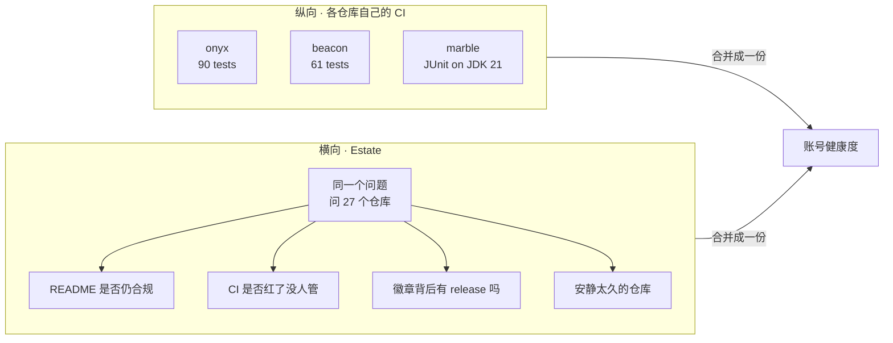

<div align="center">

# Estate

### 26 个仓库的横向体检——每周一次，从 GitHub API 直接读，不 clone

[](https://github.com/WsNodeX/estate/actions)
[](LICENSE)

</div>

---

## 它问的问题，单个仓库问不了

每个仓库自己的 CI 回答「我的代码对不对」。这个问题每个仓库都能自己答，答得比这里好——`onyx` 跑 90 个测试，`beacon` 跑 61 个，Java 那些在五个 Python 版本和 JDK 21 上跑。

Estate 问的是另一类问题，**只有站在账号层面才能问**：

- 27 个 README 里，有没有哪一个悄悄变回「写给作者」的样子
- 有没有哪个仓库的 CI 红了三天没人发现
- README 徽章写着 `/github/v/release/`，背后真的有 release 吗
- 有没有仓库半年没动过——它不会报错，只会让整个账号看起来像废弃的
- 某个仓库被 squash 合并之后，CONTRIBUTING 和 issue 表单还在吗

**一个仓库可以自己完全健康，同时是整个账号里最像被遗弃的那一个。** 这是它要抓的。

## 跑一次

```bash
GITHUB_TOKEN=xxx python scripts/estate.py --owner WsNodeX
```

```text
repo                    ★ CI         rel      health  last push  problems
--------------------------------------------------------------------------------------------
aether                  1 success    v0.1.0      100         0d
beacon                  0 success    v1.0.0      100         0d
...
quiver                  1 success    v0.1.0      100         0d
readme-forge            0 success    v1.0.0      100         0d
...
26 live · 1 archived · 0 CI red · 0 missing community files · 0 without a release
```

退出码 0 表示没有 CI 红、没有缺文件。`--fail-on warn` 会把「安静太久」也算失败。



**纵向的问题各仓库自己能答，且答得更好。横向的问题只能在账号层面问。**


## 两个设计取舍

**不 clone，只调 API。** 27 个仓库 clone 下来是几百 MB，而它要回答的问题全在 API 里现成躺着。真正需要代码的检查留给各自的 CI。

**Archived 和 profile 单独归类。** Profile 仓库是一份 README，不是项目——它没有测试、没有 release、没有贡献指南，这是设计如此。用项目标准要求它，会得到一个永远修不掉的红灯。`atlas` 是主动归档的（和 `aether` 功能重复），也不该算在健康度里。

## 一个它自己犯过的错

第一版用 `community/profile` 返回的 `issue_template` 字段判断 issue 表单是否存在。26 个仓库全部报缺失，而实际上每个都有 `.github/ISSUE_TEMPLATE/bug_report.yml`。

原因：那个字段只识别旧的 Markdown 模板，对现代的 YAML issue forms 返回 `null`——同时 `health_percentage` 仍然是 100。两个字段互相矛盾，我信了错的那个。

改成直接查目录。**API 的一个字段说「没有」，不等于文件不存在。**

## 许可证

[MIT](LICENSE)
